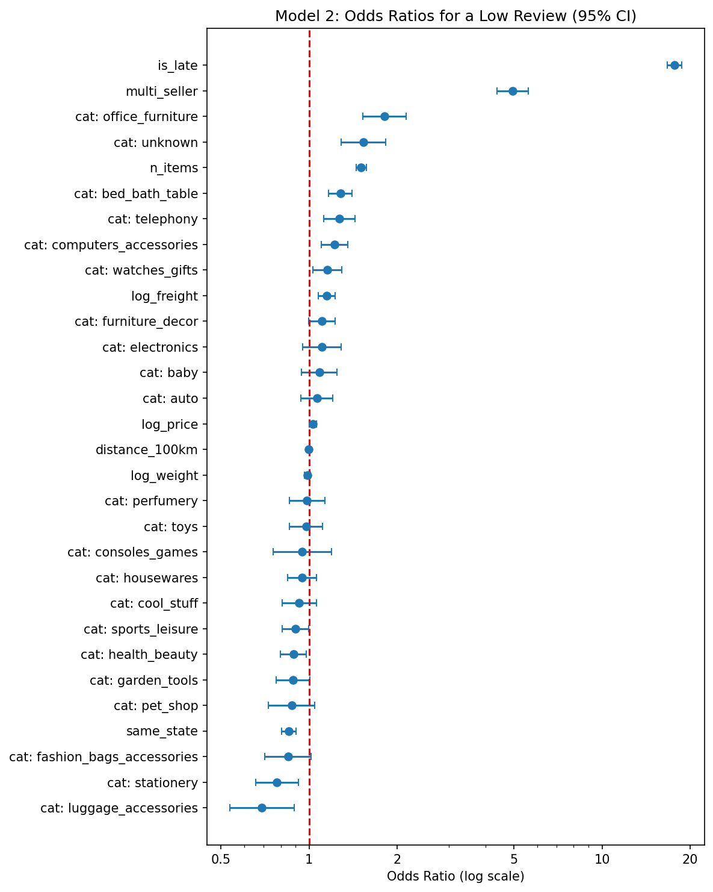

# Delivery Delays and Customer Satisfaction in Brazilian E-Commerce

**Statistical inference and predictive modelling on ~96,000 orders from the Olist marketplace**

## Overview

Late deliveries are a common source of customer dissatisfaction in online retail. Using the public Olist dataset (2016–2018), this project asks two questions:

1. **Inference:** Is delivery delay associated with low review scores after controlling for price, freight cost, distance and product category?
2. **Prediction:** Can we predict at the time of purchase whether an order will be delivered late?

## Key findings

**Delay and satisfaction**
- On-time orders receive a mean review score of **4.29**; late orders receive **2.27**.
- **54%** of late orders receive 1 star, compared with **7%** of on-time orders.
- The largest jump happens exactly when the promised date is missed: the share of low reviews (1–2 stars) rises from **11%** (0–4 days early) to **32%** (1–3 days late). Arriving very early adds little extra satisfaction (9% vs 11%).
- In a logistic regression with controls, late delivery remains the strongest predictor of a low review (**OR = 17.7, 95% CI 16.7–18.7**). Odds ratios overstate risk ratios when the outcome is common; the corresponding risk ratio is about 7.
- Orders with multiple sellers have about **5× higher odds** of a low review, probably because items arrive separately.
- Distance has no significant effect once delay is controlled for (p = 0.45), consistent with distance affecting satisfaction mainly through delay.

**Predicting late deliveries**
- On a random train–test split, Random Forest outperformed Logistic Regression (PR-AUC **0.24** vs **0.15**; random baseline 0.07).
- The most important feature was purchase month, a warning sign, because delays cluster in specific periods (Nov 2017, Feb–Mar 2018).
- With a **time-based split** (train before 26 May 2018, test after), PR-AUC fell to **0.06** (baseline 0.035). The random split overestimated real-world performance.
- Conclusion: late deliveries are only weakly predictable at the time of purchase; most delay drivers probably occur after purchase and are not in the data.

## Methods

| Stage | Notebook | Methods |
|---|---|---|
| 1–3. Data preparation | `01_data_preparation.ipynb` | Merging 8 relational tables, missing-data analysis, feature engineering (delay, haversine distance, log transforms), outlier investigation |
| 2. Exploratory analysis | `01_data_preparation.ipynb` | Dose–response analysis, 95% confidence intervals for proportions |
| 4. Statistical modelling | `02_modelling.ipynb` | Logistic regression (statsmodels), odds ratios, categorical controls |
| 5. Prediction | `03_prediction.ipynb` | Logistic Regression vs Random Forest (scikit-learn), PR-AUC, class imbalance, data leakage, time-based validation |
| 6. From scratch | `04_logistic_from_scratch.ipynb` | Logistic regression implemented with gradient descent in NumPy; coefficients match statsmodels to 4 decimal places |

## Data cleaning decisions

- 8 orders marked "delivered" without a delivery date were removed as data errors.
- For orders with several reviews, the most recent review was kept.
- 42 geolocation points outside Brazil were removed. This reduced the maximum distance from 8,678 km to 3,399 km, and the late-rate pattern by distance did not change (robustness check).
- Price, freight and weight were log-transformed because of strong right skew.
- Product categories with fewer than 1,000 orders were grouped as "other".

## Limitations

- **Observational data:** the results show associations, not causal effects.
- **Selection bias:** not every customer writes a review.
- **Right-censoring:** recent orders not yet delivered are excluded, so late rates in the final months may be underestimated.
- **Open question:** orders more than 30 days late show a lower share of low reviews (68%) than orders 15–30 days late (82%); the 95% confidence intervals do not overlap. One possible explanation, not tested here, is that some reviews were written before delivery.

## How to run

1. Download the dataset from Kaggle: [Brazilian E-Commerce Public Dataset by Olist](https://www.kaggle.com/datasets/olistbr/brazilian-ecommerce).
2. Put the CSV files in the project folder.
3. Install the requirements: `pip install -r requirements.txt`
4. Run the notebooks in order (01 → 04). Notebook 01 creates `olist_model_data.csv`, which the other notebooks use.

## Tools

Python · pandas · NumPy · matplotlib · seaborn · statsmodels · scikit-learn
